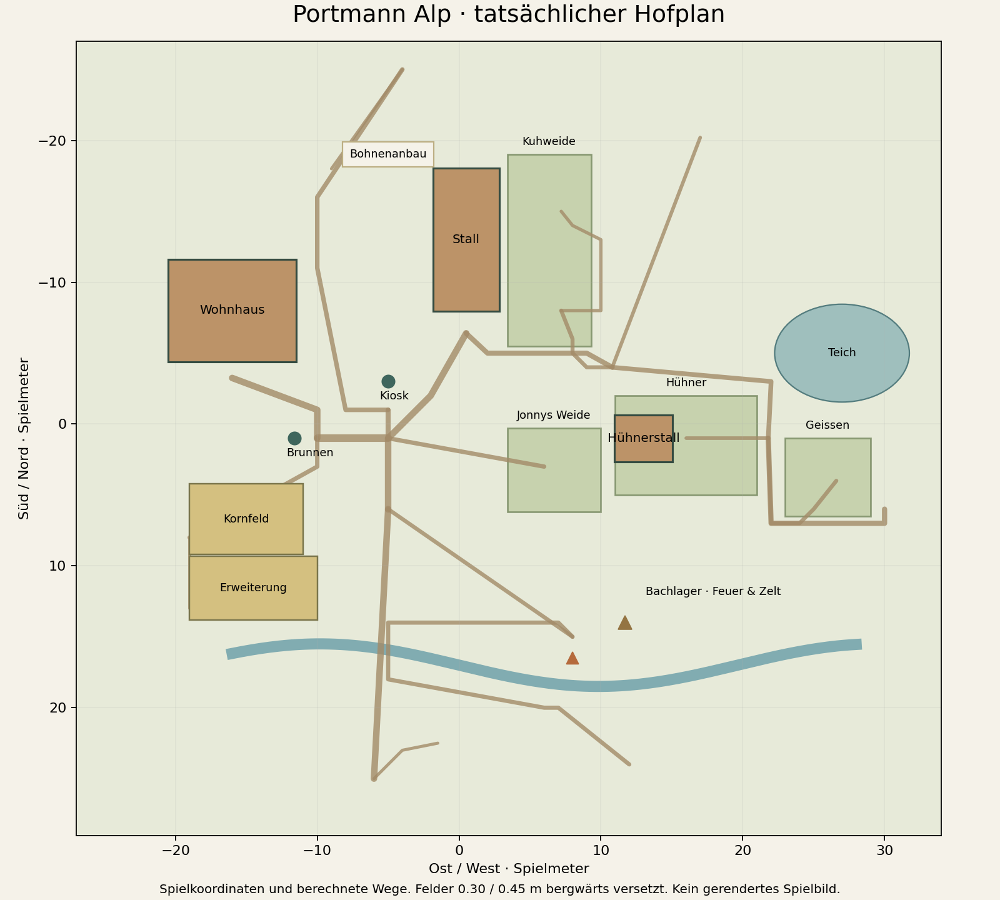

# Hofplan · Umsetzungsschritt 1

Die Positionen werden in `dist/hof-layout.mjs` gemeinsam für Modelle, Pflege, Versorgung, Erntezugänge, Gehege, Wege und Karte festgelegt.

| Element | Bisher (x, z) | Neuer Stand (x, z) | Zweck |
| --- | --- | --- | --- |
| Wohnhaus | -16, -8 | -16, -8 | Linke Hofkante bleibt bestehen. |
| Hauptstall | -32, -5 | 0.5, -13 | Rechts hinter dem Haus, innerhalb der Startansicht. |
| Berta / Lotti | -27, -1 / -27, -8 | 5.5, -9 / 5.5, -16 | Weide schliesst direkt an den Stall an. |
| Futterversorgung | -27, 5 | 0.5, -6.4 | Tagesration am Hauptstall; zweiter Unterstand entfällt. |
| Hühner / Stall | -24, 9 / -28, 9 | 16, 1 / 13, 1 | Gemeinsamer, eingezäunter Tierbereich. |
| Geissen | -27, 14 | 25, 3 | Benachbarter eigener Bereich. |
| Kiosk / Zugang | 2, -6 / 2, -4 | -5, -3 / -5, -1 | Am gemeinsamen Hofweg; keine Überschneidung mit dem Stall. |
| Teich | 19, -5 | 27, -5 | Ausserhalb der neuen Tierbereiche. |
| Bohnen-Erntezugang | -2, -15 | -9, -18 | Freier Zugang westlich des Gewächshauses. |

Haus, Brunnen, Kornfelder, Jonny und Bachlager behalten ihre Lage. Die ehemalige grosse Parcoursfreifläche wird nicht mehr von Gras und Blumen ausgespart.

Der Plan zeigt tatsächliche Spielkoordinaten und berechnete Wege. Er ist kein gerendertes Spielbild. Gebäudeformen, Bergformen und Licht wurden in diesem Paket nicht neu gestaltet.

## Prüfung

`tests/hof-layout.mjs` kontrolliert räumliche Anordnung, angeschlossene Kuhweide, erreichbare Interaktionen und Pflege-/Erntepunkte, erhaltene alte Spielstände sowie die Projektion beider Gebäudezentren in die iPad-Startansicht. Der Stall liegt rechts, das Haus links. Dies ist ein Geometrienachweis, keine visuelle 3D-Abnahme.

`tests/terrain-horizon.mjs` kontrolliert den neuen Umgebungsring ohne Flächen unter dem Nahgelände: 552 übereinstimmende Randpunkte und 675 Innenstrahlen ohne versteckte Überlagerung. Die Materialdarstellung bleibt auf der GPU zu prüfen.

## Nächster Teilstand: Fassade und Kameraumrisse

Der Hauskörper besitzt jetzt ausgesparte Front- und Giebelfenster sowie einen offenen Türausschnitt in der Wandhülle. Die Frontverkleidung spart diese Öffnungen ebenfalls aus. Scheiben und Tür sind zurückgesetzt; umlaufende Rahmen bilden die Laibungen. Zwei obere Fenster, ein ausgefüllter geschwungener Berner Giebel und sichtbare Dachsparren ersetzen vereinfachte Formen. Die Grundfläche und alle Zugänge bleiben erhalten. Diese gemeinsame Chalet-Geometrie wird auch von den bestehenden Dorf-/Stadtgebäuden genutzt.

Die nahe Kamera bleibt unverändert. `tests/hof-layout.mjs` prüft nun sämtliche acht Ecken der vollständigen Gebäude-Begrenzungsboxen, einschliesslich Dach, Galerie, Kamin und Holzunterstand, in 4:3, 16:10 und 16:9. `tests/alpine.mjs` prüft mit Strahlen die wirklich ausgesparten Öffnungen, zurückgesetzte Scheiben und den ausgefüllten Giebel mit freier Galerie.

Grenzen: keine gerenderte Sichtprüfung, keine Aussage über Schönheit, Schatten oder iPad-Leistung. Im Hochformat können seitliche Gebäude angeschnitten sein; die Spielfigur soll deshalb nicht automatisch wieder verkleinert werden. Verdeckungen beim Gehen und die endgültigen Haus-/Stallproportionen bleiben offen. Anschliessend folgt die natürliche Hanggestaltung mit Sockelanschlüssen.

## Gelände, Sockel und tatsächlich gezeichnete Wege

Die bisherige Grundlage mit zwei einzelnen Hügelkuppen und überlappenden breiten Abflachungen wurde durch einen zusammenhängenden, nach Norden/Osten ansteigenden Hang ersetzt. Westlich hinter dem Haus öffnet sich ein breiter Abstieg ins Tal. Bauflächen besitzen abgerundete Ränder und weich auslaufende Erdanschlüsse; Stall und Bohnenanbau sowie beide Felder teilen jeweils einen gemeinsamen Höhensockel. Die maximale Stichprobensteigung der Erdoberfläche sinkt im untersuchten Bereich von 1.501 auf 0.782. Dies ist ein Geometriewert, kein Nachweis einer gelungenen Landschaftsdarstellung.

Bewegung und Platzierung lesen jetzt die Höhe aus denselben Dreiecken wie der sichtbare Nahboden. Die Wege werden an den Geländedreiecken aufgeteilt: Vor dem Umbau lagen einzelne geprüfte Wegpunkte rund 13 cm im Boden, nun folgen alle 17'385 geprüften Wegdreiecke der Oberfläche mit 5 cm Abstand. Die Feldböden werden entsprechend mit 2.5 cm Abstand auf dem Gelände geführt. Die Feldmitten liegen neu bei (-15, 6.7) und (-14.5, 11.55), also 30 beziehungsweise 45 cm weiter bergwärts. Ihre Grösse sowie Versorgung und Fortschritt bleiben erhalten. Der Bach erhält ein stetiges Gefälle von Osten nach Westen; die Brücke liegt darüber.

`tests/terrain-grading.mjs` prüft Laufhöhen gegen unabhängige Strahlen auf das sichtbare Gelände, die Grundflächenränder von Haus/Stall/Hühnerstall, Wegdreiecke bis in ihre Innenflächen, vollständige Ackerflächen ohne schwebende Bodenplatten und den Wasser-/Brückenabstand. Die Erhaltung von Wegfläche und UV-Koordinaten wird zusätzlich an einem nicht ebenen Testgelände geprüft. Alte Vorgaben, die einen künstlichen Hügel unter der Hütte oder zwingend Steintritte auf nun flacheren Hofwegen verlangten, wurden durch Prüfungen des gesamten Hanggefälles und einen eigenständigen Test für steile Wegabschnitte ersetzt.

Offen bleiben eine gerenderte Sichtprüfung, echte iPad-/Mac-Leistungswerte, weitere Gebäudeproportionen und die charakteristische Modellierung der Schweizer Berge. Die zusätzliche Wegunterteilung erhöht die Dreieckszahl, ohne neue Wegmaterialien oder Zeichenobjekte einzuführen; ihre tatsächliche Geräteleistung ist noch nicht gemessen.

## Aktueller Folgestand · Dach, Stall, Tal und Figuren

Die frühere Tabelle dokumentiert den ersten Hofschritt. Aktuell steht der Hauptstall bei (1.5, -13), mit Grundfläche 6.8 × 7.4 und Zugang (1.5, -7.7). Berta und Lotti stehen bei (7.8, -9) und (7.8, -16); die angeschlossene Kuhweide reicht von x=5.5 bis 11.4 und z=-19 bis -5.5. Der maschinenlesbare Hofplan enthält diese aktuellen Koordinaten. Die früheren Planbilder und der Gelände-Vorher/Nachher-Vergleich bleiben historische Nachweise des jeweiligen Schritts.

Haus und Stall besitzen nun durchgehende, leicht geschwungene Dachflächen mit dünnen einzelnen Schindeln. Der Stall wurde breiter und niedriger modelliert, mit Holzaufbau, Steinsockel, ausgesparter Tür und offenem Heuboden. Die westliche Flanke fällt stärker ab; der Seespiegel liegt jetzt bei -61.73 gegenüber ungefähr +3 auf dem Hof. Der Alpblick verwendet eine eigene schräge Panoramakamera; die nahe Laufkamera bleibt erhalten. Die gemeinsame Farbpalette und die sechs Figurenprofile sind in ART_DIRECTION.md beschrieben.

Die frühere maximale Hangsteigung von 0.782 gehört zum vorangegangenen Geländeschritt. Die neue steile Aussenflanke wird getrennt von den nutzbaren Hofterrassen geprüft. Eine gemessene Höhenänderung bedeutet noch keine gelungene alpine Bildwirkung. Die aktuelle Grenze bleibt: keine gerenderte Sichtabnahme, keine Safari-Touch-Abnahme und keine gemessene Geräteleistung.

## Rückwärtiger Bach und zwei klare Wegführungen

Der aktuelle maschinenlesbare Plan wurde erneut aktualisiert: Bach hinter dem Haus, Brücke bei x=-24, Feuerstelle und Zelt am rückwärtigen Ufer, seitlicher Waldaufstieg zum Bergübergang (-17,-28), vorne ein abfallender Weg mit Kehren Richtung Dorf. Der Übungsfels liegt nun im Gebiet Panoramaweg. Die Felder folgen dem Hang. Die historischen Planbilder zeigen diesen neuen Stand nicht; aktuelle Koordinaten stehen in hof-layout.json und alp-landscape-plan.mjs. Die grafische Gesamtprüfung bleibt offen.

## Begehbare Flächen und Bachquelle

Der seitliche Panorama-See ist im aktuellen Stand entfernt. Der Nahboden ist innerhalb x=-54…54, z=-50…50 begehbar, soweit Gebäude, Felsen, Wasser und Weidezäune den Weg nicht physisch sperren. Die Wegsuche verbindet freie Zielpunkte mit sichtbaren Rasterankern. Der Bach verläuft nun von einer Felsquelle bei (-11, streamZ(-11)) bis zur westlichen Geländekante bei x=-54. Er biegt an beiden Enden zurück und bleibt hinter dem Haus; die Brücke bei x=-24 ist die einzige Hofquerung. Erdwegflächen werden dort ausgespart. Aktuelle Grundparameter stehen in alp-landscape-plan.mjs, der kurvige Verlauf in landscape-height.mjs.

Das Hausinnere hat eigene lokale Koordinaten, gespeicherte Möbelpositionen und vier Bereiche: Stube, Schlafzimmer darüber, Käsewerkstatt darunter und eine angeschlossene Reifehöhle. Aussenposition und Regionsübergänge werden unabhängig davon gespeichert. Der Portmann-Store in der Stadt kauft reife Alpprodukte bei (15,-5) an; er ist auch über die örtliche Karte erreichbar.

## Mobiler Hofzugang und Stall

Der Hauptstall ist durch das Tor an (1.5,-8.7) betretbar. Ein Mittelgang führt bis in den Stall; die frühere Vollblock-Kollision wurde durch passende Wand-/Boxenflächen ersetzt. Beim Betreten erfolgt eine Dach-Schnittansicht. Die Versorgung am alten Aussenpunkt bleibt erhalten; ein zweiter Zugriff im Stall teilt dieselbe Tagesration. Der Hühnerstall steht bei (13.5,1) und zeigt nach Westen, mit zusätzlichem Tor bei (11,1). Seine gedrehte Grundfläche beträgt 3.3 × 4.1. Das alte Hofbild und frühere Lageplanabbildungen dokumentieren frühere Stände.

## Ergänzung: Ernte und Lagerplatz (17.10.2026)
- Heuwiese: Mittelpunkt (-35,7), 6×5; freier Zugang (-30.8,7). Leihsichel am Feldrand; sechs Mähzüge, dann 8 Heu abholen. Einmal je Spieltag; Nachwachsen nach einer Spielnacht.
- Separater Lagerplatz am Hofteich: Feuer/Grill (33,-10), Zugang (32,-9.5), Zelt (36,-12). Schnitzen: Holz → Werkzeugstiel. Rösten: Marshmallow → essbarer gerösteter Marshmallow. Übernachten setzt einen regulären Spieltag weiter.
- Dorf-Futterladen: Zugang (14,-5.5); Heu, Körner und Marshmallows zum Kauf.
- Elf Obstbäume: Apfel, Zwetschge, Kirsche; zehn zusätzliche Bergahorn-/Vogelbeer-Kronen im unteren Waldsaum. Keine neue Obsternte zugesagt.
- Rückwärtiger Bach und Bachlager um vier Meter bergwärts versetzt. Querung bleibt auf der Brücke. Bachbett auch nach Geländeüberblendung vertieft.
- Border Collie begleitet die Figur auf der Alp ausserhalb von Haus, Aktivitäten und Panorama. Kollisionsgeführte Wegsuche; keine Fütterungs-/Pflegepflicht für den Hund.
- Panoramablick am vorderen Bänkli sowie beim oberen Aussichtspunkt: Kamera auf Augenhöhe, Schwenktasten und veränderlicher Bildwinkel 54–18 Grad. Echte begehbare 3D-Welt; keine Fototapete oder geografisch vermessene Aussicht.
- Reiten, Skifahren und Klettern verwenden automatische Ego-Kameras. Käse, Jass, Retro- und Zielspiele behalten ihre nahen Arbeits-/Tisch-/Zielansichten; Heu, Schnitzen und Rösten zeigen die arbeitenden Hände.
- Radioliste: Summer Walk (Standard), Alpine Echoes, Acoustic Folk, Donut, Backyard, drizzle, Driving On Country Roads, Midnight Bliss, Store, Afternoon, Married Life, Folk. Schrittaufnahme als Umgebungsgeräusch. Moderne Ogg-Unterstützung für zusätzliche Titel nötig, Fehler fällt auf MP3-Haupttitel zurück.
- Grafik/GPU, echter iPhone-/iPad-Touch und Audioausgabe sind hier nicht gerendert/getestet.
